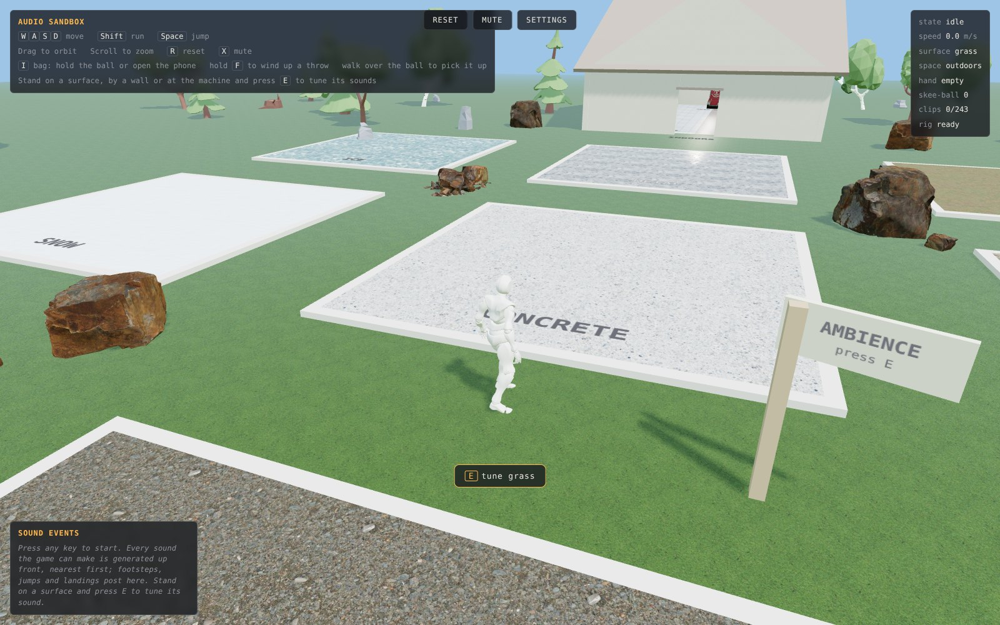

# Audio Sandbox

A third-person 3D playground where every sound effect is generated by Stable Audio 3 as you play.



## Try it

**Hosted:** https://maxfieldhulkersai.github.io/audio-sandbox/

Open Settings (top bar) and paste your own Stability API key. The key stays in your browser's localStorage and is sent only to `api.stability.ai`. Get one at https://platform.stability.ai/account/keys. Generated clips are cached in your browser (IndexedDB), so the second visit is free.

**Local:** no build step. Serve the folder with any static server and open it.

```
npx serve .
# or
python3 -m http.server 8000
```

Open http://localhost:8000. Opening `index.html` straight from disk will not work because the textures and animation clips are fetched over HTTP.

## What it does

You walk a character around a grass field with nine surface pads (concrete, gravel, ice, metal, moss, sand, slate, snow, water), a small indoor room with wood and linoleum floors, some walls to throw at (brick, plaster, sheet metal, glass, a plank fence), a bag with a ball and a phone in it, and a skee-ball machine. Every footstep, jump, landing, ball bounce, score chime, menu click and the ambience bed is a clip generated by Stable Audio 3 from a prompt template. On first load the game generates the whole sound set, nearest things first, then plays from cache. Stand on a surface, next to a wall, or at the machine and press E to open a tuning card: describe what it should sound like, regenerate, audition the takes, pick one. The phone in your bag opens Stable Stack, a merge puzzle game whose sounds were made the same way.

## How it was built

A single HTML file, no framework and no build step. Three.js r128 (vendored in `vendor/`) draws the scene; the character is a Mixamo rig with eight FBX animation clips stored as base64 text and parsed in the browser with FBXLoader. Footsteps fire on the clips' foot-plant frames, so the walk and run sounds line up with the animation. Sound effects are organised by surface and event: each has a prompt template with `{surface}`, `{object}` and `{space}` slots, and each event keeps one to four takes so repeated footsteps do not sound identical. Clips are fetched with four requests in flight, retried with a backoff on 429, decoded with Web Audio, and stored in IndexedDB keyed by prompt plus generation settings. Static hosting on GitHub Pages; the browser calls the Stability API directly with the key you paste in. About 2,000 lines plus a 5 MB bundled copy of Stable Stack. MIT licensed.

## How it uses Stable Audio

- **Text to Audio** (`POST /v2beta/audio/stable-audio/text-to-audio`): generates every sound effect. One call per take, with `model=stable-audio-3`, `duration` from 1 s (footsteps) to 30 s (the ambience bed), `steps` 8 and `cfg_scale` 7 by default (both adjustable in Settings), a random `seed`, and `output_format` mp3 or wav. The response is a 202 with an id; the game polls `GET /v2beta/audio/results/{id}` every 1.5 s until it gets a 200 with the audio bytes, up to two minutes.

Model: `stable-audio-3`

Prompt templates ship in the file (`DEFAULT_TPL` in `index.html`) and can be edited in-game. The templates describe what the sound is made of rather than what it lacks, because the model does not understand "no" or "without".

## Project structure

| Path | Role |
| --- | --- |
| `index.html` | The whole game: scene, character controller, physics, sound registry, Stability client, tuning UI. The Stability calls live in the `apiGenerate` function near the `Stability API` comment. |
| `stack/index.html` | Stable Stack, the merge game on the in-game phone. Self-contained with its sounds embedded. |
| `assets/*.fbx.txt` | Mixamo character rig and animation clips, base64-encoded FBX. |
| `assets/tex/*.jpg` | Surface and prop textures. |
| `vendor/` | Three.js r128, FBXLoader and fflate, copied from the `three@0.128.0` npm package (MIT). |
| `.github/workflows/pages.yml` | Publishes the repo root to GitHub Pages on push to `main`. |
| `docs/screenshot.jpg` | The image at the top of this README. |

## License

MIT, see [LICENSE](LICENSE). Character rig and animations are from Mixamo and are subject to Adobe's Mixamo terms.
